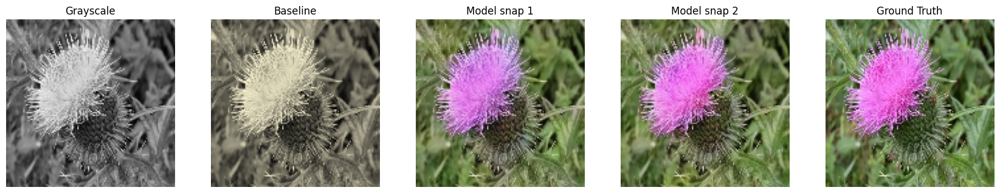
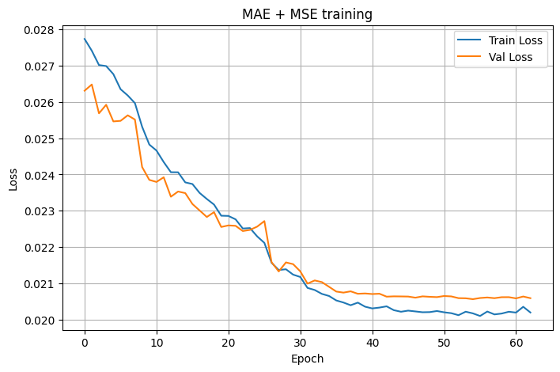
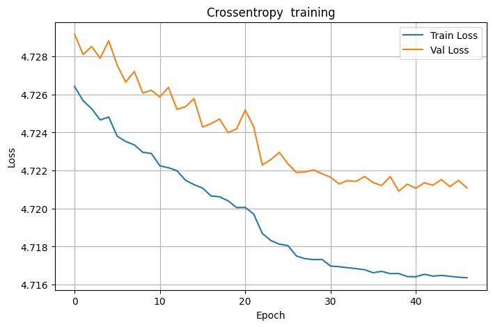

# Deep Learning Course Project 
## University of Bologna
### Tommaso Bergonzoni

This repository contains my delivery for the Deep Learning Project required by the Deep Learning course at the University of Bologna. Everything is explained inside the notebook.

<p align="left">
  <a href="https://colab.research.google.com/github/TommyBergo/DeepLearningProject/blob/main/Colorization-Tommaso_Bergonzoni-DLProject.ipynb"></a>
  
  
  
</p>

---

## 🎨 Palette-conditioned image colorization

The goal of the project is to **add colors to a grayscale image**, given one extra hint: the **mean intensity of the red, green and blue channels** of the original picture (its average "palette").

The palette tells the network *how much* of each color the image contains overall, but not *where* that color goes. The model has to work that out from the shapes and textures in the grayscale image, for example that petals are pink while leaves and background are green.

<p align="center">
  
  <br>
  <em>Left to right: grayscale input, professor's baseline, model after stage 1, final model (stage 2), ground truth.</em>
</p>

## 📌 Project at a glance

| | |
|---|---|
| **Task** | Grayscale → RGB colorization, conditioned on the mean RGB palette |
| **Dataset** | [Oxford Flowers 102](https://www.robots.ox.ac.uk/~vgg/data/flowers/102/) (8,189 flower images, 102 classes) via `tensorflow_datasets` |
| **Input** | Grayscale image `128×128×1` + palette vector `(R, G, B)` |
| **Output** | RGB image `128×128×3`, values in `[0, 1]` |
| **Model** | U-Net with FiLM conditioning (~3.05M parameters) |
| **Training** | Two stages: MAE + MSE, then channel-wise cross-entropy + MSE |
| **Metric** | Per-image MSE of the model divided by the MSE of the baseline (lower is better) |
| **Final score** | **0.4828 ± 0.5483**, about **half the baseline error** |

## 🧠 How it works

### Data
- Images are resized to **128×128** and normalized to `[0, 1]`.
- The full Flowers102 dataset (`train+validation+test`) is split into **train / validation / test (80% / 10% / 10%)**.
- The `GrayScaleGenerator` provided by the professor builds each batch: the grayscale image is the mean of the three channels, and the palette is the mean color over all pixels. The target is the original RGB image.

### Model: U-Net + FiLM
The network is a **U-Net-like encoder–decoder** (`depth = 3`, base width `40`):

- **Input fusion:** the palette is tiled into a `128×128×3` map and concatenated to the grayscale image, so the color hint is available from the very first convolution.
- **Encoder:** `Conv–BN–ReLU ×2` blocks followed by max pooling. Each stage saves a skip connection.
- **Bottleneck:** the deepest, most abstract representation of the image.
- **Decoder:** upsampling, concatenation with the matching skip connection, and convolutions to recover fine detail.
- **Output:** a `1×1` convolution to 3 channels with a **sigmoid** activation.

On top of that, every encoder block, the bottleneck and every decoder block use **FiLM (Feature-wise Linear Modulation)**. Two small dense layers turn the palette into a per-channel scale `γ` and shift `β`, which are applied to the feature maps:

$$
y = (1 + \gamma) \cdot x + \beta
$$

This injects the global color information at every level of the network, not just at the input, and gives noticeably more consistent colorizations.

### Two-stage training
Both stages use **Adam** (learning rate `3e-4`), batch size `32`, and the same callbacks:
- `ReduceLROnPlateau`: halves the learning rate when the validation loss stalls (patience 3, minimum `1e-6`).
- `EarlyStopping`: stops after 8 epochs without improvement and restores the best weights.
- `ModelCheckpoint`: saves the best weights to Google Drive.

| Stage | Loss | Why | Epochs |
|---|---|---|---|
| **1** | `0.5 · MAE + 0.5 · MSE` | MAE is robust to outliers, MSE punishes large errors. Together they give stable learning of the overall structure and colors. | Early-stopped at 63 (best: 55) |
| **2** | `0.5 · Channel-wise Cross-Entropy + 0.5 · MSE` | Each RGB channel is treated as a probability distribution over the pixels, which rewards putting the color in the *right places*. MSE keeps the pixel-wise accuracy. | Early-stopped at 47 (best: 39) |

<p align="center">
  
  
</p>

## 📊 Results

Evaluation follows the professor's protocol. For every test image and every channel, the MSE of the model is compared with the MSE of a simple **baseline**, which scales the grayscale image by `palette / mean(gray)` for each channel. The **final score** is the mean (and standard deviation) of the ratio `MSE_model / MSE_baseline`. A score below `1` means the model beats the baseline.

Results on **2,624 test images**:

| Model | Mean MSE | Std MSE | **Score (mean ratio)** | Std ratio |
|---|---|---|---|---|
| Baseline | 0.009565 | 0.010614 | 1.000 | – |
| Stage 1 (MAE + MSE) | 0.003281 | 0.003715 | 0.5233 | 0.5161 |
| **Stage 2, final model (CE + MSE)** | **0.002792** | **0.003347** | **0.4828** | **0.5483** |

Per-channel breakdown of the final model:

| Channel | Mean MSE (model) | Mean MSE (baseline) | Mean ratio |
|---|---|---|---|
| 🔴 R | 0.002852 | 0.010122 | 0.5587 |
| 🟢 G | 0.002718 | 0.008833 | 0.5004 |
| 🔵 B | 0.002807 | 0.009741 | 0.3894 |

**Takeaways**
- The final model cuts the reconstruction error to **less than half of the baseline** on average (score **0.48**). Its mean MSE is about **3.4× lower**.
- The second training stage with the channel-wise cross-entropy improves the score from **0.523 to 0.483** (about 8% better) on top of an already converged model.
- **Blue** is the easiest channel to recover and **red** the hardest. This fits the dataset: backgrounds are mostly green foliage, while the red and pink tones are concentrated in the petals, which vary a lot between species.

## 🚀 How to run the notebook

The notebook was developed on **Google Colab** with a GPU, and that is the easiest way to run it.

1. Click the **Open in Colab** badge at the top of this page, or upload `Colorization-Tommaso_Bergonzoni-DLProject.ipynb` to Colab.
2. Select a GPU runtime: **Runtime → Change runtime type → GPU** (e.g. T4).
3. Run the cells from top to bottom:
   - the **pretrained weights** of both training stages are downloaded automatically from Google Drive with `gdown` (`best_RGB_model_1.weights.h5`, `best_RGB_model_2.weights.h5`);
   - the Oxford Flowers 102 dataset is downloaded automatically by `tensorflow_datasets`.
4. **Evaluate only (fast):** skip the `model.fit(...)` cells and run the cells that rebuild the model and load the downloaded weights (`model_snap_1`, `model_snap_2`). Then run the test and visualization cells.
5. **Retrain from scratch (optional):** run the training cells. Training mounts your Google Drive and saves checkpoints to `MyDrive/Colorizer/`, so you need to authorize Drive access when asked. Each stage takes roughly 10 minutes on a Colab GPU (about 9 s per epoch).

> **Running locally?** Install `tensorflow`, `tensorflow-datasets`, `torch`, `scikit-image`, `pandas`, `matplotlib` and `gdown`, then remove the `from google.colab import drive` import and the Drive-mount cell. Point `CKPT_PATH_1` and `CKPT_PATH_2` to a local folder instead.

## 📁 Repository structure

```
.
├── Colorization-Tommaso_Bergonzoni-DLProject.ipynb   # Full project: data, model, training, evaluation
├── images/                                           # Figures used in this README
└── README.md
```
